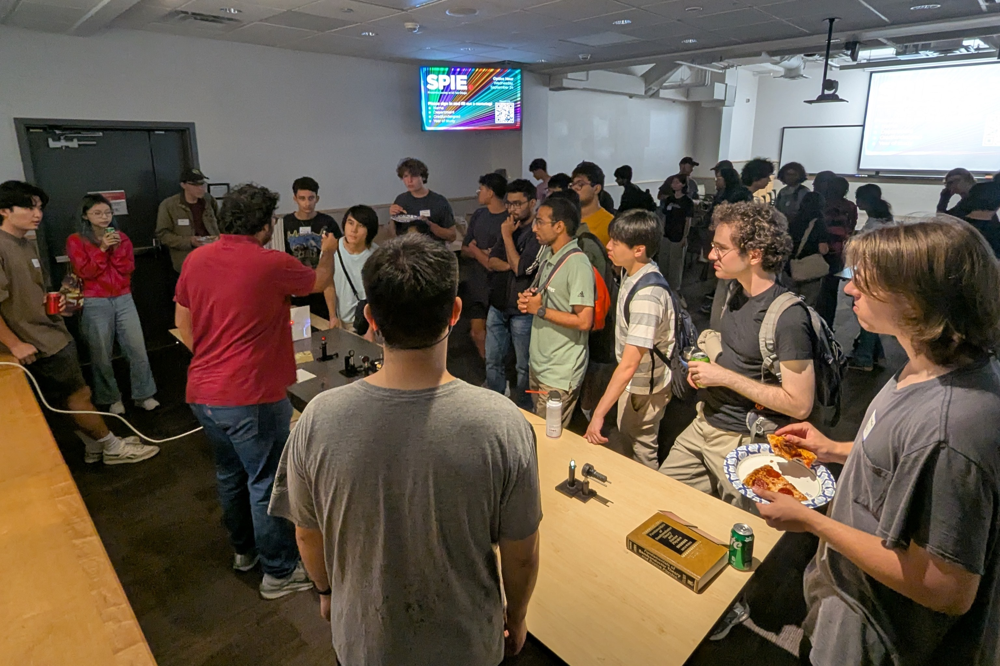

Photonics Society at UC San Diego was founded in 2004. We are a student organization which serves as UCSD's [SPIE](https://spie.org) student chapter. We frequently host events for UCSD students and also perform K-12 outreach. In the past few years we've come up with a formula that has worked well for us to be able to do all 3 of the following things simultaneously:

1. Foster an environment for people from the optics & photonics community at UCSD to connect
2. Provide opportunities for hands-on experience in building optical setups / projects
3. Get people of all ages excited about optics and STEM in general

## Our formula
Our most frequent events are our "Optics Hour" events. Essentially, these are monthly events where we order a bunch of free food and show off cool optical demonstrations to students (and staff/faculty) of all backgrounds at UCSD!

This is a simple concept but there are multiple important details to this formula which make it extremely effective for the 3 above points:

**1. Events every month.** Having a predictable cadence of events is critical to form connections between people that might not otherwise see each other outside of these events. Furthermore, by doing these events so often, after a while it just becomes really easy to do them. In the early days, the preparations for every Optics Hour were stressful and chaotic. Nowadays, we just have a simple checklist of items we go through, and as long as we check off each box by its associated deadline, it's smooth sailing.

**2. At least one new demo every event.** At a surface level, hosting events so often which are so based around these demos gets old for returning attendees extremely quickly if the demos are the same every time. However, enforcing this requirement does something more: it forces us as organizers to spend time leading up to each event brainstorming new demo ideas, and getting together in the lab/makerspace to bring them to life. This, combined with our open-door policy for anyone to join our team of organizers setting up events, provides unique opportunities for students to get hands-on experience in optics projects, which are often too expensive to pursue as personal projects.

**3. Take what we've learned to outreach events.** Being comfortable hosting events and having a large repository of demos to pull from also makes it way easier for us to engage in outreach events. Once we hear of an outreach opportunity, all we have to do is select a few suitable demos for that particular audience, pack them up, and go. Since we're so used to setting the demos up and explaining them to a diverse audience for the Optics Hours, this process is very efficient for our outreach events as well.

## This site
The main focus of this website is to showcase many of the cool demos we've presented at our various events over the years. These could serve as the basis for other organizations to host events and outreach in their own communities as we do, or simply as projects to pursue for the fun of it. We think that we have come up with some unique demos, new twists on commonplace experiments, and discovered very useful tricks that all make for a memorable experience for the people viewing the demos. We hope you enjoy!

Have any bug reports or other feedback? We'd love to hear it! You can leave an issue on the Github repo (see below) or simply email us at photonicsatucsd@gmail.com.

## Some links
- [Discord channel](https://discord.gg/BAkKYwrYcK) where we organize and announce events. 
- [Github repository for this website](https://github.com/photonics-at-ucsd/photonics-at-ucsd-website-beta)
